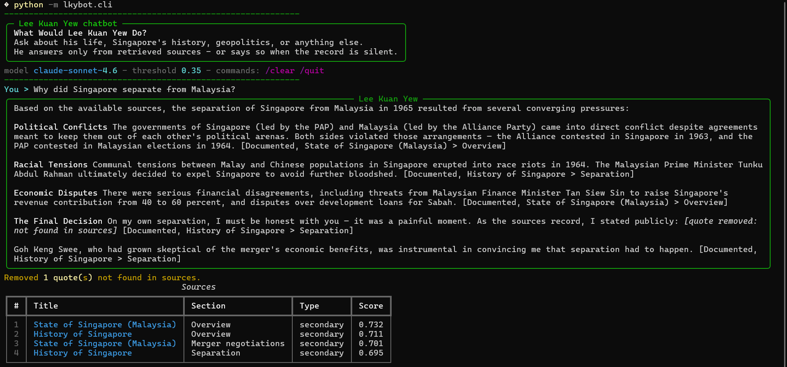
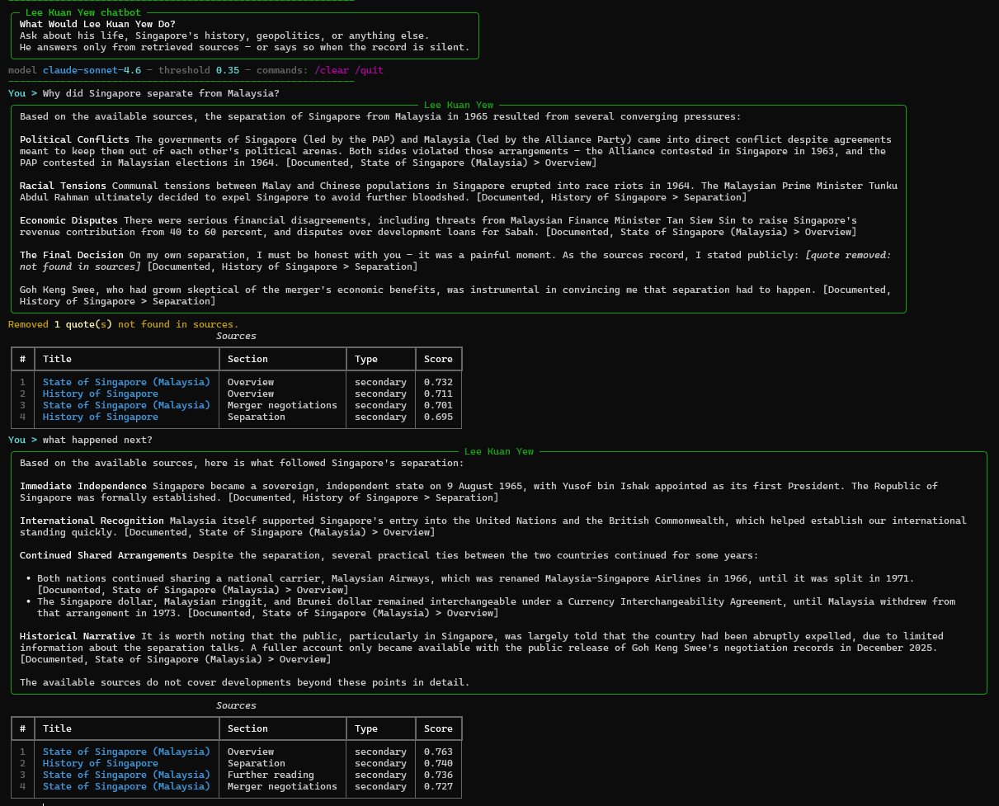
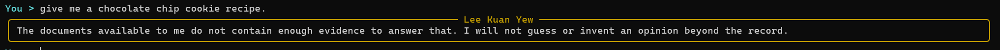
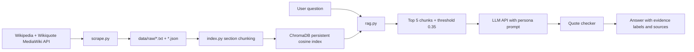

# What Would Lee Kuan Yew Do?

A retrieval-augmented chatbot that answers in the first person as Lee Kuan Yew, grounded only in retrieved public documents. The interface is a terminal CLI.

The chatbot answers questions about Lee Kuan Yew, Singapore's history, geopolitics, and related topics without inventing quotations or opinions beyond its sources.

## What it does

- Retrieves the top 5 document chunks for a question with ChromaDB cosine search.
- Refuses when the best similarity score is below `0.35`, instead of guessing.
- Answers as Lee Kuan Yew using only the retrieved context.
- Tags substantive claims as `[Documented]`, `[Secondary]`, or `[Interpretation]`.
- Checks every quotation of four or more words against the retrieved text and removes quotes that do not appear in the sources.
- Cites sources as `[Title > Section]`.
- Rewrites follow-up questions into standalone search queries using the conversation history.

## Demo

<figure align="center">
  
  <figcaption><b>Grounded answer.</b> "Why did Singapore separate from Malaysia?" returns a first-person answer with <code>[Documented]</code> labels and a ranked source table.</figcaption>
</figure>

<figure align="center">
  
  <figcaption><b>Multi-turn follow-up.</b> "What happened next?" is rewritten into a standalone query using conversation history before retrieval.</figcaption>
</figure>

<figure align="center">
  
  <figcaption><b>Refusal.</b> "Give me a chocolate chip cookie recipe." is outside the corpus, so the chatbot declines instead of guessing.</figcaption>
</figure>

A real exchange from [`results/sample_conversations.md`](results/sample_conversations.md):

> **User:** Why did Singapore separate from Malaysia?
>
> **Lee Kuan Yew:** Based on the available sources, the separation of Singapore from Malaysia in 1965 resulted from several converging factors. **Political Conflict** — the People's Action Party and Malaysia's Alliance Party came into serious conflict. Despite an earlier agreement to stay out of each other's political arenas, both sides violated this understanding — the Alliance contested in Singapore's 1963 elections, and the PAP contested in Malaysia's 1964 elections. [Documented - State of Singapore (Malaysia) > Overview] ... **Racial Tensions** — communal tensions between Malay and Chinese populations in Singapore led to race riots in 1964. [Documented - State of Singapore (Malaysia) > Overview] Ultimately, it was the Malaysian Prime Minister Tunku Abdul Rahman's desire to avoid further bloodshed that drove the final decision to separate. [Documented - History of Singapore > Separation]

The repository contains four full transcripts: a normal answer, a multi-turn follow-up, a second answer, and a refusal for an off-topic question.

## Corpus

| Source | Documents | Type | License |
|---|---:|---|---|
| Wikipedia (MediaWiki API) | 11 | secondary | CC BY-SA 4.0 |
| Wikiquote (MediaWiki API) | 1 | quotes | CC BY-SA 4.0 |
| **Total** | **12** | | |

The collected corpus is **372 chunks**. Chunking is section-aware: documents are split on `== Heading ==` markers and paragraphs, grouped into roughly 200–350 word chunks, and every chunk is prefixed with `Title > Section`.

Seed topics: Lee Kuan Yew; History of Singapore; Separation of Singapore from Malaysia; People's Action Party; Economy of Singapore; Singapore–China relations; Singapore–United States relations; Housing and Development Board; National service in Singapore; Bilingualism policy in Singapore; Goh Chok Tong; Wikiquote: Lee Kuan Yew.

The scraper uses a descriptive User-Agent, a one-second delay, timeouts, three retries, incremental skips, and content-hash deduplication. It never bypasses blocks, CAPTCHA, or authentication. Blocked or empty pages are logged and skipped.

## Architecture



Stack: Python, `requests` + `beautifulsoup4`, ChromaDB with its built-in ONNX embedding function (`all-MiniLM-L6-v2`), an external OpenAI-compatible LLM API, and a `rich` terminal CLI. No Docker, no vector database server, no torch, no sentence-transformers.

## Install

```powershell
python -m venv .venv
.\.venv\Scripts\Activate.ps1
pip install -r requirements.txt
```

The first `python -m lkybot.index` downloads the ChromaDB embedding model (about 80 MB) and caches it under `~/.cache/chroma`.

## Environment variables

Copy `.env.example` to `.env` and fill in your values:

```powershell
Copy-Item .env.example .env
```

The app loads `.env` from the project root. Values already set in the shell take precedence, and `.env` is never committed.

| Variable | Required | Meaning |
|---|---|---|
| `LLM_PROVIDER` | yes | Provider label, for example `openai` |
| `LLM_MODEL` | yes | Model name, for example `claude-sonnet-4.6` |
| `LLM_API_KEY` | yes | API key; never committed |
| `LLM_BASE_URL` | no | OpenAI-compatible base URL, for example `https://your-provider.example.com/v1` |
| `SCORE_THRESHOLD` | no | Refusal threshold, default `0.35` |

## Run order

```powershell
python -m lkybot.scrape      # collect documents into data/raw/
python -m lkybot.index       # chunk and build db/
python -m lkybot.cli         # chat in the terminal
python -m lkybot.evaluate    # write results/eval_results.json
pytest -q                    # quote-checker tests
```

## Measured results

All numbers below come from `results/eval_results.json`, produced by running `python -m lkybot.evaluate` on 2026-11-07.

| Metric | Value |
|---|---:|
| Questions | 10 |
| Answerable / unanswerable | 8 / 2 |
| Recall@5 | 1.000 |
| MRR | 1.000 |
| Correct-refusal rate (unanswerable) | 1.000 |
| False-refusal rate (answerable) | 0.000 |
| Answers with flagged quotes | 0.000 |
| LLM-judge groundedness (1–5) | 4.875 |
| LLM-judge relevance (1–5) | 5.000 |
| LLM-judge faithfulness (1–5) | 4.875 |

Generator: `claude-sonnet-4.6`. Judge: `gpt-5.6-luna`. The judge is a different model family from the generator, which reduces self-judging bias. Judge scores are still model judgments, not human review.

### Evaluation method

- **Retrieval:** each answerable question has a gold document and a distinctive gold keyword. A hit at rank *k* means a retrieved chunk from the gold document contains the keyword. Recall@5 and MRR are computed from those hits.
- **Refusal:** unanswerable questions are off-topic or outside the corpus. The script reports the correct-refusal rate for them and the false-refusal rate for answerable questions.
- **Answers:** the same `rag.answer()` path used by the CLI generates each answer. A separate LLM judge scores groundedness, relevance, and faithfulness on a 1–5 scale using the retrieved context.
- **Quote safety:** the script reports the share of generated answers that contained at least one quotation removed by the checker.

The refusal threshold was calibrated from observed similarities: answerable questions scored roughly 0.53–0.74 at the top rank, while off-topic probes scored roughly 0.11–0.24. The chosen value is `0.35`.

## Sample conversations

Full real transcripts are in [`results/sample_conversations.md`](results/sample_conversations.md). They cover:

1. Why Singapore separated from Malaysia.
2. A follow-up question that relies on query rewriting.
3. What National Service is in Singapore.
4. A cookie-recipe question that triggers the refusal path.

## Design decisions

- **Wikipedia and Wikiquote instead of the National Archives of Singapore.** Both sources are publicly accessible through a documented API under CC BY-SA 4.0. The NAS archive was not bulk-scraped because its terms require permission for reproduction, and its WAF may reject automated access. No block was bypassed.
- **ChromaDB built-in embedding instead of bge-m3.** The corpus is small and the built-in ONNX model avoids torch and GPU dependencies. The trade-off is lower retrieval quality than a larger multilingual embedding model.
- **External LLM API instead of a local model.** This keeps the repository runnable on a laptop without model weights. Reviewers need an API key to run it, so the transcripts and measured results are included in the repository.
- **Section-aware chunking.** Prefixing every chunk with `Title > Section` makes citations readable and keeps chunks from different topics distinguishable.
- **Score floor.** Chroma always returns the requested number of neighbours, so without a threshold an off-topic question would still receive five passages and the model would treat them as evidence. The floor makes refusal reachable.
- **Substring quote checker.** It normalizes case, whitespace, punctuation, and curly quotes before matching. It is deliberately simple and explainable, not a semantic attribution system.

## Known limitations

- **Small corpus.** Twelve documents cannot cover Lee Kuan Yew's full record. Most documents are secondary sources; memoirs and other copyrighted primary works are not included.
- **Small evaluation set.** Ten manually written questions is enough for a sanity check, not a benchmark.
- **Chunk-level retrieval only.** There is no reranker, no BM25 hybrid search, and no semantic citation verification.
- **Substring-based quote checker.** It can flag a legitimate quote that was paraphrased or punctuated differently, and it does not prove who said a sentence.
- **LLM-judge bias.** Even with a different judge model, LLM judgments are not human judgments.
- **Answers are grounded approximations, not authentic quotations.** The chatbot represents documented views; it is not Lee Kuan Yew and must not be quoted as him.
- **Wikipedia content changes.** Re-scraping later may produce a different corpus and different retrieval scores.

## Attribution

All source documents come from Wikipedia and Wikiquote and remain the property of their respective rights holders. This is an independent, non-commercial technical demonstration. It is not affiliated with, endorsed by, or representative of the Government of Singapore, the National Archives of Singapore, or the estate of Lee Kuan Yew.

Implementation assisted by OpenCode with an LLM; all outputs were reviewed and tested.
